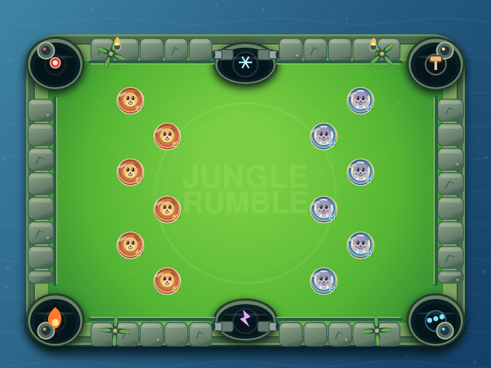
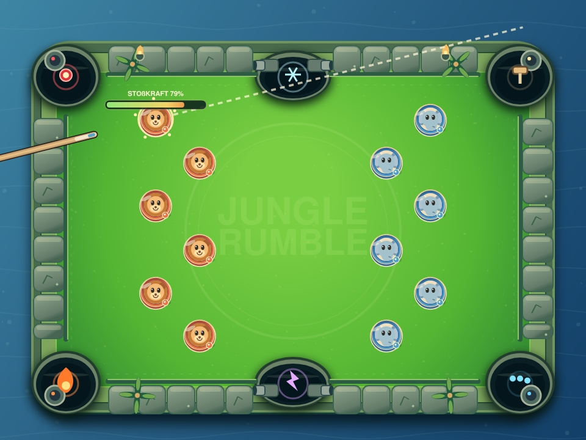
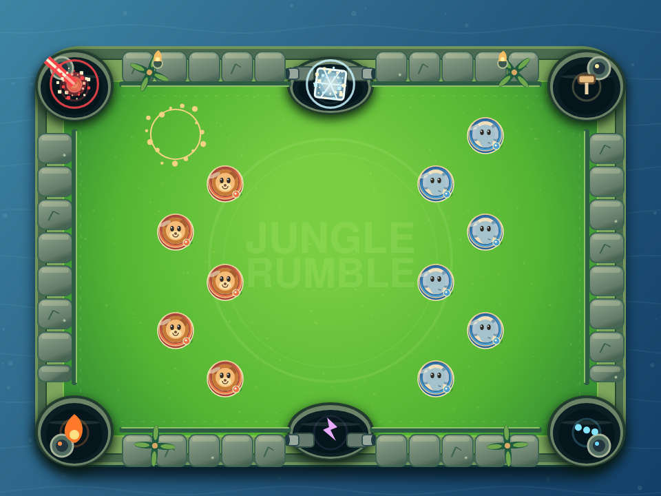

# ZOOPALOOLA REVIVAL 🦁 🎱

### Kleine Tiere. Große Duelle. Zurück an den Billardtisch!

**Ein kostenloses, unabhängiges Fanprojekt, inspiriert vom ICQ-Klassiker Zoopaloola.**

[**Spielregeln**](#so-spielst-du) · [**Solomodus**](#solo-gegen-den-computer) · [**Screenshots**](#screenshots) · [**Das Original**](#danke-an-das-original)

## Willkommen zurück im Dschungel

Zoopaloola Revival ist Tier-Billard ohne weiße Kugel: Sechs deiner Kugeln stehen sechs gegnerischen gegenüber. Jede eigene Kugel darfst du anstoßen. Wer seine Gegner in die Taschen befördert und seine eigene Tierbande behält, gewinnt.

- 🎯 **Solo gegen den Computer:** drei Schwierigkeitsgrade.
- 🧑‍🤝‍🧑 **Online gegen Freunde:** private Räume mit Einladungslink, zum Beispiel für Discord.
- 🎮 **Lokal zu zweit:** beide spielen abwechselnd an einem Gerät.
- 🎱 **Billard-Physik:** spürbare Bande, präzise Kollisionen, Queue, Zielhilfe und Stoßkraft.
- ⚡ **Sechs Spezialtaschen:** Jede Falle verabschiedet die Kugeln mit einer eigenen Animation und Soundeffekten.
- 🔁 **Revanche:** mit wechselnder Startaufstellung.

## So spielst du

1. Wähle **dein Tier** (Löwe, Elefant, Affe oder Nilpferd) und einen Spielmodus.
2. **Klicke oder tippe auf eine eigene Kugel.** Ziehe den Queue in die entgegengesetzte Richtung deines gewünschten Stoßes.
3. Die **Zielhilfe** zeigt die Stoßrichtung und den ersten möglichen Kugeltreffer; der Balken zeigt die Kraft an.
4. **Loslassen:** Deine Kugel rollt, prallt von Banden ab und stößt andere Kugeln an.
5. **Versenke alle sechs gegnerischen Kugeln**, ohne selbst alle zu verlieren. Nach jedem Stoß wechselt der Spieler – auch bei einem Treffer.

### Solo gegen den Computer

Wähle **Solo spielen** und stelle den Schwierigkeitsgrad ein:

| Schwierigkeit | Was dich erwartet |
|---|---|
| **Einfach** | Lockerer Einstieg mit gelegentlichen Fehlschüssen |
| **Normal** | Der Computer prüft mehr Stoßmöglichkeiten |
| **Schwer** | Bessere Schussauswahl anhand simulierter Kugelbahnen |

Der Computer spielt **selbstständig auf dem Server** – ein zweites Browserfenster ist nicht nötig.

### Mit Freunden spielen

Klicke auf **Privaten Raum erstellen**, kopiere den Einladungslink und schicke ihn deinem Freund über Discord. Sobald er beitritt, beginnt die Partie. Oder wähle **Lokal zu zweit** für einen gemeinsamen Bildschirm.

## Sechs Taschen. Sechs spektakuläre Fallen.

Wie an einem klassischen Billardtisch gibt es **vier Ecktaschen und zwei mittige Taschen** an den langen Seiten. Wo Kugeln im echten Billard einfach verschwinden, warten hier verschiedene Überraschungen:

| Tasche | Was beim Versenken passiert |
|---|---|
| Oben links | 🔴 Laser – brutzelt die Kugel weg |
| Oben Mitte | ❄️ Eis – friert die Kugel ein und lässt sie zerbrechen |
| Oben rechts | 🔨 Hammer – hämmert die Kugel platt |
| Unten links | 🔥 Feuer – lässt die Kugel in Flammen verschwinden |
| Unten Mitte | ⚡ Strom – zerlegt die Kugel in Funken |
| Unten rechts | 💦 Wasser – mit einem kräftigen Platscher |

Alle Grafiken und Soundeffekte sind neu für dieses Fanprojekt erstellt.

## Screenshots

**Die neue Sechs-Taschen-Arena**

**Billard-Queue, Zielhilfe und Stoßkraftanzeige**

**Wenn der Laser eine Kugel wegbrutzelt**

## Danke an das Original

Zoopaloola und sein wildes Tier-Billard gehören zu den schönsten Erinnerungen an die ICQ-Spiele der 2000er-Jahre. Danke an die damaligen Entwickler und Künstler für die Idee und all die nostalgischen Matches.

- [Gameplay-Video: *Zoopaloola Online – ICQ Games* (6games, 2022)](https://www.youtube.com/watch?v=pTyRH9i6BP0)
- [Historischer Spieltest (Pocket Gamer, 2008)](https://www.pocketgamer.com/zoopaloola/review/)

**Hinweis:** Dies ist ein inoffizielles, eigenständig erstelltes Fanprojekt ohne Verbindung zu damaligen Rechteinhabern. Es verwendet keine übernommenen Originalgrafiken, Musikaufnahmen, Stimmen oder Sounddateien. Die genannten Namen dienen der Einordnung und Hommage.
